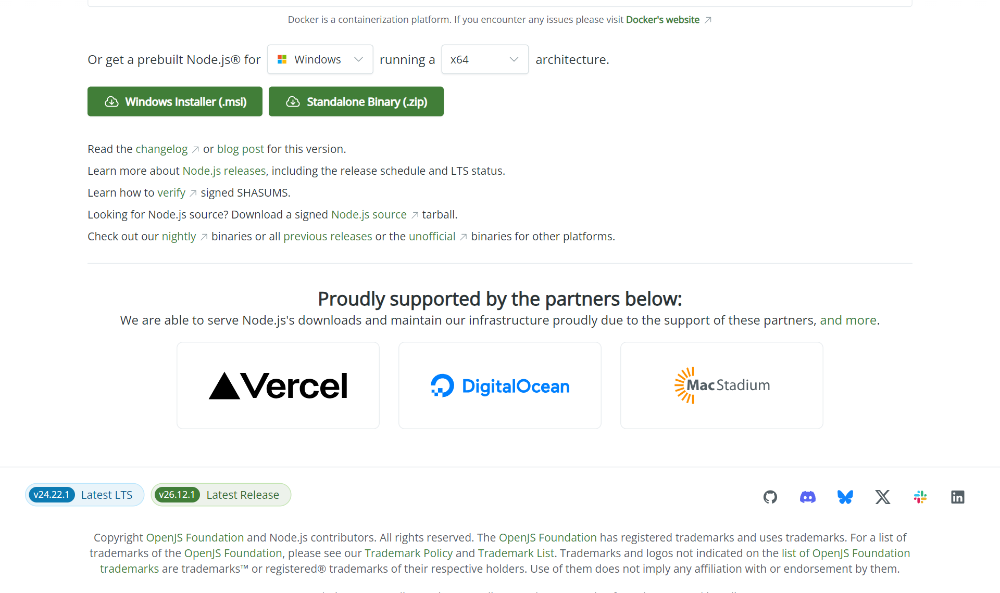

# 1.3 Node.js installeren

### Windows

1. Ga naar `https://nodejs.org/en/download`.
2. Kies de versie met **LTS** erbij. Op het moment van schrijven is dat **24**.
3. Download de **Windows Installer (.msi)** en start ze.
4. Klik door de installer met de standaardkeuzes.
5. Op het scherm **Tools for Native Modules** laat je het vinkje **uit**.



> **BEGRIP — LTS**
>
> **LTS** staat voor *Long Term Support*. Een LTS-versie krijgt drie jaar lang
> veiligheidsupdates. De andere versie, **Current**, krijgt de nieuwste functies, maar
> wordt na enkele maanden niet meer onderhouden.
>
> *Waarom LTS:* bedrijven draaien hun servers op LTS. De pakketten die je dit jaar
> gebruikt, worden getest op LTS. Met Current loop je tegen fouten aan die niemand
> anders heeft.

> **LET OP**
>
> Laat het vinkje bij **Tools for Native Modules** uit. Het installeert Chocolatey,
> Python en de bouwhulpmiddelen van Visual Studio: meer dan een gigabyte, en je hebt het
> dit jaar nergens voor nodig.

### macOS

1. Ga naar `https://nodejs.org/en/download`.
2. Kies de LTS-versie en download de **macOS Installer (.pkg)**.
3. Doorloop de installer.

### Linux

Gebruik `nvm`, de versiebeheerder van Node. De installatie-instructies staan op
`https://github.com/nvm-sh/nvm`. Daarna:

```bash
nvm install 24
nvm use 24
```
