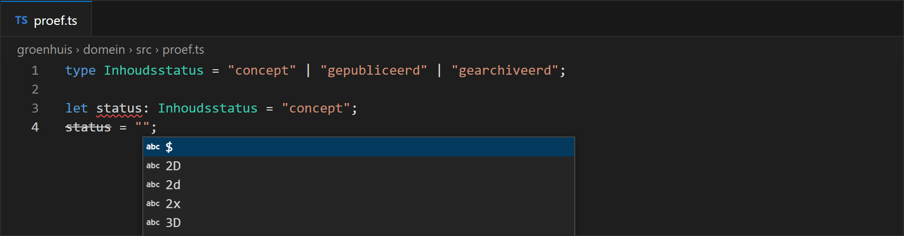

# 6.1 Literal types

Ga met de muis over deze twee variabelen:

```ts domein/src/proef.ts
let soort = "kamerplant";
const vast = "kamerplant";
```


Een `let` kan later een andere tekst krijgen, dus is het type `string`. Een `const`
krijgt nooit een andere waarde, dus is het type **precies die tekst**: `"kamerplant"`.

> **BEGRIP — Literal type**
>
> Een **literal type** is een type met één mogelijke waarde: `"kamerplant"`, `6`, `true`.
>
> *Waarom je er iets aan hebt:* samen met `|` beschrijf je een **vaste reeks** toegelaten
> waarden. Een btw-tarief in België is 6, 12 of 21 procent, niet 7:

```ts domein/src/proef.ts
type Btwtarief = 0 | 6 | 12 | 21;
type Inhoudsstatus = "concept" | "gepubliceerd" | "gearchiveerd";

let tarief: Btwtarief = 6;
tarief = 7;

let status: Inhoudsstatus = "concept";
status = "gepubliseerd";
```

```text
src/proef.ts:5:1 - error TS2322: Type '7' is not assignable to type 'Btwtarief'.

5 tarief = 7;
  ~~~~~~

src/proef.ts:8:1 - error TS2820: Type '"gepubliseerd"' is not assignable to type 'Inhoudsstatus'. Did you mean '"gepubliceerd"'?

8 status = "gepubliseerd";
  ~~~~~~

Found 2 errors in the same file, starting at: src/proef.ts:5
```

Een tikfout in een status is nu een typefout. En typ je `status = "`, dan stelt VS Code
de drie toegelaten waarden voor:



> **WAAROM**
>
> In JavaScript zou je dat met een tekst doen, en hopen dat iedereen `"gepubliceerd"` juist
> spelt. In PHP of Java zou je een `enum` gebruiken. TypeScript kent ook een `enum`, maar
> een union van literal types doet hetzelfde, verdwijnt volledig bij het wegvegen van de
> types, en werkt dus met Node zonder vertaalstap. Hoofdstuk 18 vergelijkt de twee.
